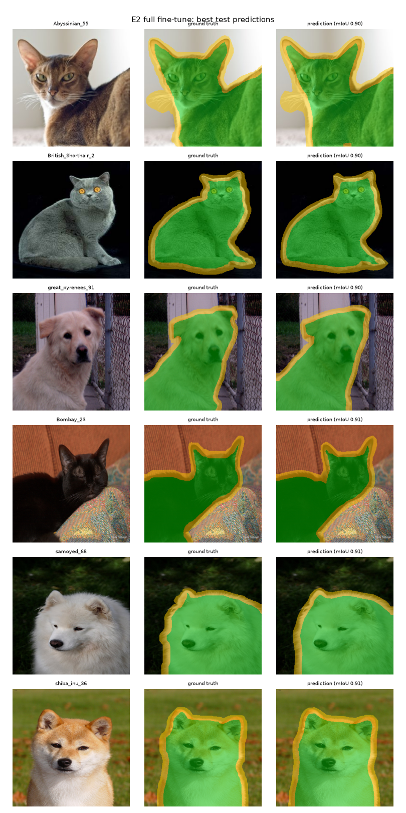
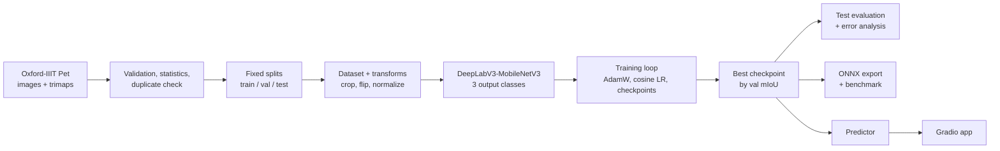
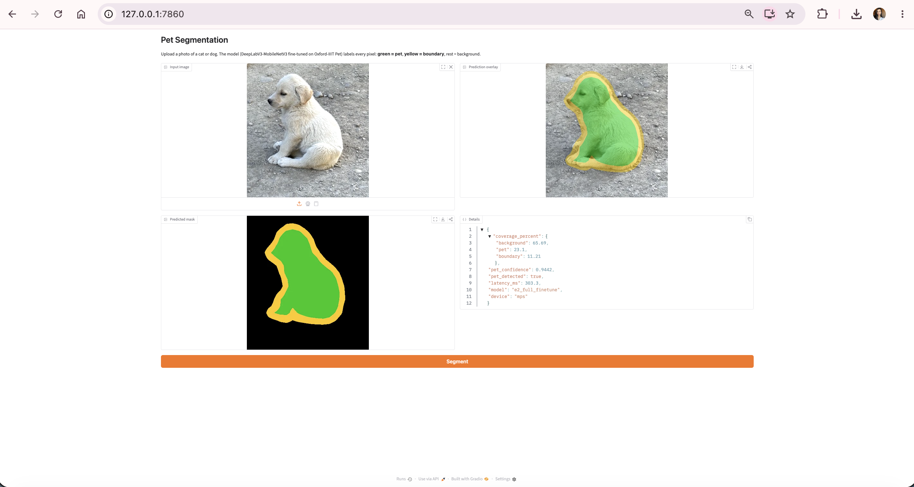

# Pet Segmentation: Three-Class Semantic Segmentation on Oxford-IIIT Pet

End-to-end computer vision project: a pretrained **DeepLabV3-MobileNetV3-Large** (torchvision)
is fine-tuned to label every pixel of a cat or dog photo as **background**, **pet** or **boundary**.
It covers the full ML lifecycle: dataset validation, a zero-shot baseline, three controlled
fine-tuning experiments, held-out test evaluation with error analysis, a measured inference
optimization (ONNX Runtime) and a Gradio demo application.



## Results (held-out test set, 3,669 images)

| Model | Val mIoU | Test mIoU | Test foreground IoU | Test IoU pet | Test IoU boundary | Test mean Dice |
|---|---|---|---|---|---|---|
| E0 zero-shot (pretrained, no training) | 0.5499 | 0.5450 | 0.8285 | 0.7507 | 0.0000 | 0.5987 |
| E1 fine-tune head only | 0.7770 | 0.7836 | 0.9071 | 0.8628 | 0.5570 | 0.8687 |
| **E2 full fine-tune (selected)** | **0.7880** | **0.7958** | **0.9132** | **0.8735** | **0.5781** | **0.8773** |
| E3 full fine-tune + class-weighted loss | 0.7594 | 0.7745 | 0.8912 | 0.8515 | 0.5589 | 0.8638 |

The model was selected on **validation** mean IoU; the test set was used once, at the end.

**Optimization (CPU, Apple M1, 4 threads, batch size 1, validation set):**

| Configuration | Val mIoU | Median latency | Speed-up |
|---|---|---|---|
| PyTorch, 320 px (baseline) | 0.7880 | 103.3 ms | 1.00x |
| **ONNX Runtime, 320 px (deployed choice)** | **0.7880** | **33.9 ms** | **3.05x** |
| PyTorch, 224 px | 0.7402 | 71.0 ms | 1.45x |
| ONNX Runtime, 224 px | 0.7402 | 24.3 ms | 4.25x |

Details: [experiment report](reports/experiments.md) · [technical report](reports/technical_report.md) · [AI usage report](reports/ai_usage_report.md)

## Problem

Given a photo of a cat or dog, produce a pixel-accurate mask separating the animal, its
uncertain outline (boundary) and the background. Useful as a building block for photo editing
(background removal), pet-camera analytics or dataset labelling.

## Dataset

[Oxford-IIIT Pet](https://www.robots.ox.ac.uk/~vgg/data/pets/) (Parkhi et al., 2012): 7,349
images of 37 breeds with trimap masks (pet / background / boundary). License: CC BY-SA 4.0.
The dataset is downloaded by a script and is not stored in this repository.

| Item | Value |
|---|---|
| Corrupted or invalid samples | 0 (3 non-RGB images, converted automatically) |
| Near-duplicate images removed across splits (perceptual hash) | 26 |
| Splits (train / val / test) | 3,105 / 549 / 3,669 |
| Pixel share in trainval (background / pet / boundary) | 59.9% / 29.2% / 11.0% |

`test` is the official test list (unchanged). `train`/`val` is a breed-stratified 85/15 split of the
official trainval list (seed 42). Split files are committed in [`splits/`](splits/).

## Architecture



**Model choice.** DeepLabV3 with a MobileNetV3-Large backbone: small (11M parameters, 44 MB),
fast enough for CPU inference, well supported in torchvision, and its published weights were
trained with Pascal VOC classes that include `cat` and `dog`. That makes a genuine zero-shot
baseline possible (E0). For fine-tuning, only the last 1x1 convolution is replaced (21 → 3 classes).

## Project structure

```
configs/              experiment configs (E1, E2, E3)
splits/               committed train / val / test image lists
src/petseg/
  data/               parsing, validation, splits, duplicates, Dataset, transforms
  models/             model construction, checkpoint loading / export
  training/           training loop (checkpointing, resume, early stopping)
  evaluation/         confusion-matrix metrics (IoU, Dice) and evaluation loop
  inference/          Predictor for new images, ONNX export
  app/                Gradio interface
scripts/              command-line entry points (download, inspect, train, evaluate, benchmark, app)
tests/                53 automated tests (synthetic data, no downloads)
reports/              technical report, experiment report, AI usage report, figures, result tables
```

## Setup

Python 3.12. Tested on macOS (Apple M1) for development/inference and Kaggle (NVIDIA T4) for training.

```bash
python3.12 -m venv .venv
source .venv/bin/activate
pip install -r requirements.txt
pip install -e .
python -m pytest -q          # 53 tests
```

## Reproduce

```bash
python scripts/download_data.py --root data      # ~800 MB
python scripts/inspect_data.py                   # validation + statistics + example figure
python scripts/make_splits.py                    # splits + duplicate removal (already committed)
python scripts/evaluate_baseline.py              # E0 on validation
```

**Training** (GPU recommended; runs on CPU/MPS but slowly):

```bash
python scripts/train.py --config configs/e1_head_only.yaml
python scripts/train.py --config configs/e2_full_finetune.yaml
python scripts/train.py --config configs/e3_weighted_loss.yaml
python scripts/train.py --config configs/e2_full_finetune.yaml --resume    # continue after interruption
python scripts/train.py --config configs/e1_head_only.yaml --smoke-test    # 2-batch pipeline check
```

On Kaggle (free T4 GPU, Internet on): clone the repository, run
`pip install -e . --no-deps` (keeps Kaggle's preinstalled PyTorch), download the data, then
run the three commands above. All three experiments took about 15 minutes in total.

**Evaluation, optimization, weights:**

```bash
python scripts/evaluate_models.py     # test-set table + error analysis (artifacts/results/)
python scripts/export_weights.py      # best experiment -> artifacts/weights/petseg_deeplabv3_mbv3.pt
python scripts/benchmark.py           # PyTorch vs ONNX Runtime, 320 vs 224 px
```

## Trained weights

Download the trained model (E2, 44 MB) from the GitHub release:

```bash
python scripts/download_weights.py
```

Or regenerate it with the training commands above, followed by `python scripts/export_weights.py`.

## Demo application

```bash
python scripts/run_app.py             # then open http://127.0.0.1:7860
```

Upload any cat or dog photo and click **Segment**. The app shows the overlay
(green = pet, yellow = boundary), the predicted mask, class coverage, mean pet confidence and latency.
Invalid input (no image, images smaller than 32 px) produces a clear error message.



## Limitations

- **10-epoch budget** (deadline). E1 and E2 reached their best validation score in the last epoch,
  so they were probably still improving.
- **One run per configuration** (single seed). Differences of about 0.01 mIoU (E1 vs E2) may be within seed-to-seed variation.
- Metrics are computed on 320x320 resized masks, not at the original image resolution.
- **Label noise:** several of the worst-scored test images have empty or inverted ground-truth masks;
  the boundary class is inherently ambiguous.
- ONNX export uses PyTorch's legacy TorchScript exporter (deprecated in recent PyTorch, still functional).
- The demo runs locally; no public deployment.

## Reproducibility

Fixed seeds (42) for splits, data order and initialization; pinned dependency versions;
committed split files; every run saves its exact config (`config.json`) and per-epoch history.
GPU training is not bit-for-bit deterministic, so retraining gives similar, not identical, numbers.

## Licenses

Code: MIT (see `LICENSE`). Dataset: Oxford-IIIT Pet, CC BY-SA 4.0. Pretrained weights:
torchvision (BSD-3-Clause), trained on COCO.
